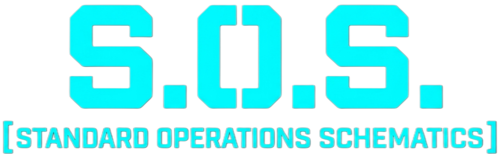

# Introduction

**S.O.S** is an ecosystem of mods that aims to add a comprehensive unified information system on top of the base game, whether about vanilla content or third-party mods, allowing players to obtain the necessary information or analysis in real time for any Barotrauma game in a very simple and integrated way. (eg. Crafting recipes, Detailed medical information, Talents, Recipe tracker, etc.)

This mod is totally compatible with mods from C# with hard references, C# with references by reflection and coming from Lua.

## Dependences

It depends on the [LuaCsForBarotrauma](https://github.com/evilfactory/LuaCsForBarotrauma) ecosystem.

> [!TIP]
> If you are wondering how to get started with CSharp/Lua modding, please read [LuaCsForBarotrauma Guide](https://evilfactory.github.io/LuaCsForBarotrauma) to get you started making Barotrauma mods.

## Contents List

**Recomended to start:** [**Introductory Guide**](guide.html)

- [SOS - Core](core.html)
- [1. Getting Started](getting_started.html)
- [2. SOS Modules](sos_modules.html)
- [3. Registration](registration.html)
- [4. Data Sharing](data_sharing.html)
- [5. UI and GUI Components](ui_comps.html)

### Other Resources

#### Helpful Links

 <!--116699 -->
